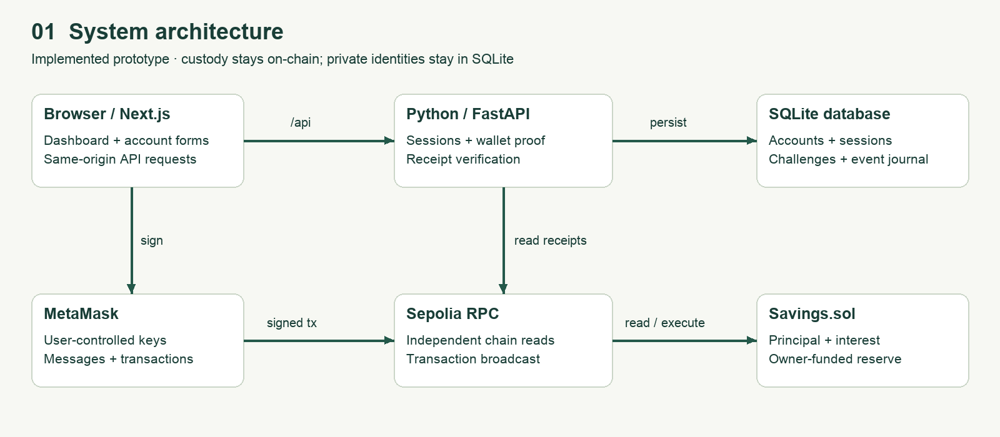
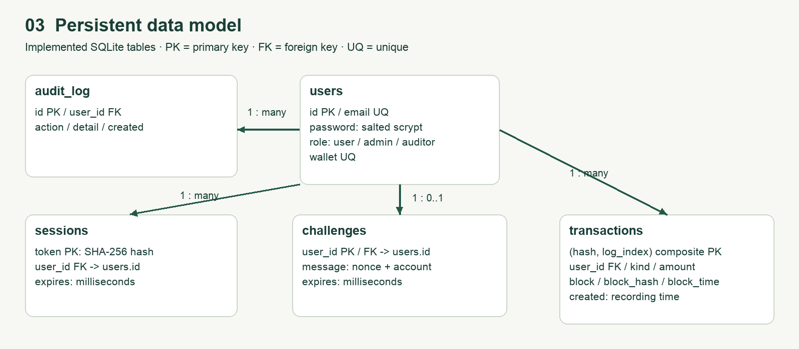
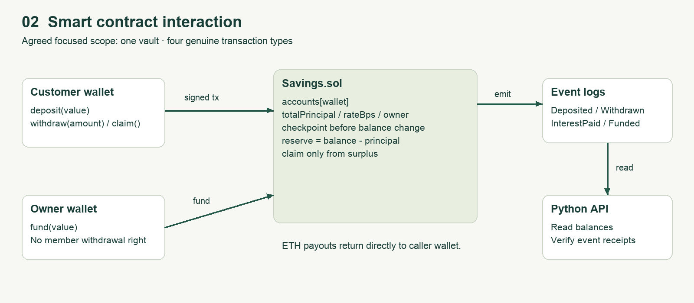
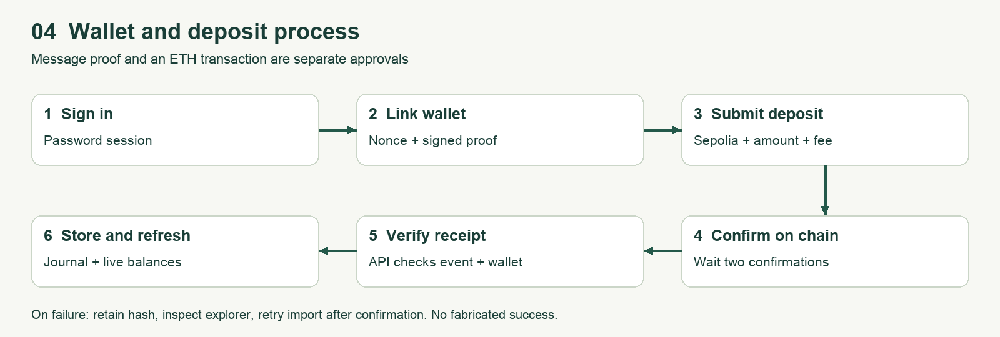
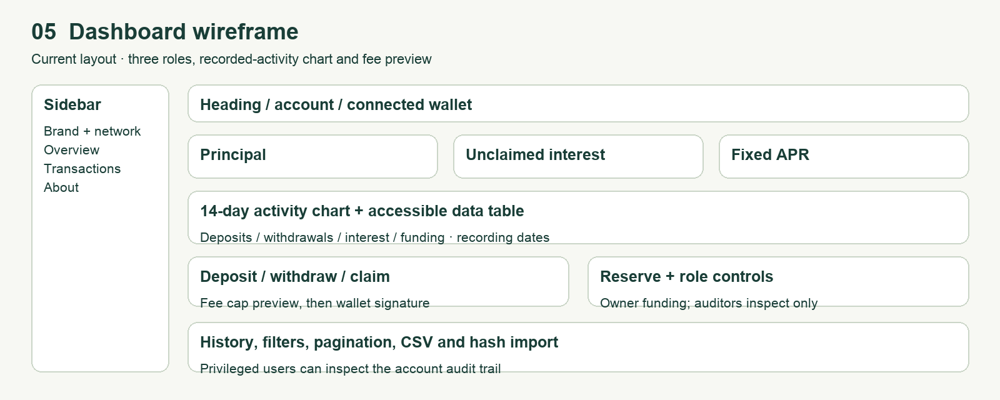

# Saving: transparent, wallet-controlled savings
## Enterprise Financial DApp — technical report
Zeran Yao · G2509029A · Sole contributor · 18 October 2026

### Executive abstract
Saving is a Sepolia prototype for a sponsor-funded savings scheme. Participants deposit test ETH, retain the right to withdraw principal, and claim simple interest from a separately accounted reserve. The intended business setting is a small, crypto-literate membership organisation offering an auditable savings incentive. The prototype tests whether members can verify balances and payouts without relying solely on an operator's spreadsheet. It does not demonstrate a sustainable investment return or a licensed savings product.

The implementation combines a Next.js dashboard, MetaMask transaction signing, a Python/FastAPI REST service, SQLite persistence, and a Solidity vault. Password sessions identify application users; a signed, expiring challenge links each account to a wallet. Contract accounting protects principal from interest payouts. Docker and a Render Blueprint describe hosting, while a reportable local test suite validates selected behaviours.

### Assessment status
The original brief guides the design. The revised project scope prioritises a Python backend and practical improvements under the agreed flexible requirements. The agreed scope retains one focused savings contract and four meaningful business transaction types rather than adding unrelated features to reach counts. Customer, Administrator and Auditor roles, dashboard charting, exports and a fee preview are now implemented. Public deployment and performed-demo evidence remain pending. The original count differences remain explicit in the scope matrix.

### Reading map
Pages 2–4: problem, stakeholders and requirements. Pages 5–9: architecture, data, contracts, process and security. Pages 10–12: measured testing, gas and deployment. Page 13: contribution and compliance. Page 14: references. Editable diagrams, user instructions, slides and demonstration materials accompany this report.
<!-- PAGE -->
# 1. Real-world problem and evidence
### Specific problem
A small membership organisation may wish to sponsor savings incentives while allowing members to check whether the promised rate and their principal are accounted for correctly. An operator-controlled spreadsheet can describe balances, but members cannot independently enforce its payout rules. In a crypto-native scheme, a publicly inspectable contract can make the custody boundary and interest formula explicit. This is a proposed problem framing, not a finding from interviews with a real organisation.

The identifiable initial users are members who already understand Ethereum wallets, a treasury sponsor with a finite reward budget, and a reviewer checking the scheme's records. Requiring existing wallet literacy deliberately narrows the target group. The current app is not suitable for people who need cash access, deposit insurance, account recovery, or stable purchasing power.

### External evidence and its limits
The World Bank's Global Findex 2025 release reports that 40% of adults in developing economies saved in financial accounts in 2024, compared with 24% in 2021 [1]. This provides context for the importance of accessible saving tools. It does not establish demand for this DApp, prove a blockchain advantage, or validate the proposed membership use case.

BIS Papers No. 156 discusses information asymmetry, market inefficiency and financial stability concerns in decentralised finance [2]. This cautions against equating an inspectable contract with a trustworthy financial outcome. Saving's reserve can run short, a wallet can be compromised, and a software defect can still cause loss.

### Existing alternatives
A bank or regulated savings provider is the stronger default for ordinary fiat savings and customer support. A centralised member portal is simpler when participants accept a single operator. A spreadsheet is low-cost for a very small trusted group. Saving becomes worth investigating only where participants already hold crypto assets and specifically value independently executable accounting. No cost or accessibility superiority over these alternatives has been measured.
<!-- PAGE -->
# 2. Stakeholders, value and feasibility
### Stakeholder analysis
| Stakeholder | Need and responsibility | Current support / unresolved issue |
| --- | --- | --- |
| Member / customer | Verify principal, earn and claim incentive, leave scheme | Deposit, balance, claim, withdrawal; no password recovery |
| Treasury administrator | Budget reserve and inspect recorded activity | Invited admin role; owner wallet funds reserve |
| Independent auditor | Reconcile cross-account wallet evidence | Invited read-only role; emails withheld |
| Service operator | Keep API and records available | Docker and disk configuration; no operational SLA |
| Assessor | Reproduce tests and inspect contribution evidence | Source, scripts and reports; public evidence pending |

### Why blockchain may fit
The contract provides a common execution rule for custody and payouts. Members sign transactions with their own wallet; an application administrator cannot silently reduce a user's stored principal. Events provide public transaction evidence that can be compared with the portal's journal. These are technical properties of the proposed workflow, not evidence of user adoption.

A conventional portal can deliver much the same interface, usually with better recovery and lower transaction friction. The specific extra property investigated here is independently executable withdrawal and accounting even if the portal is unavailable. A user would still need the contract address, ABI, an Ethereum interface and a working RPC service. Contract defects and chain availability remain shared risks.

### Practical and ethical constraints
Interest is a sponsor subsidy. It does not come from lending, staking or external revenue. The administrator must budget funds before claims can succeed. ETH denomination introduces price volatility; Sepolia ETH has no investment value. A visible annual percentage must not be presented as a guaranteed real-money return.

Public addresses and events can reveal financial behaviour. The private database additionally links email addresses to wallets, so restricted access and a retention policy matter. Wallet onboarding and irreversible signing can disadvantage less experienced users. No deployment jurisdiction, licensing analysis, privacy assessment or real-money approval has been completed; a qualified assessment would be needed before any public financial service launch.
<!-- PAGE -->
# 3. Requirements and success criteria
### Functional traceability
| ID | Requirement | Actual status / evidence |
| --- | --- | --- |
| F1 | Three authenticated roles | Implemented: customer, admin, auditor |
| F2 | MetaMask and wallet signing | Implemented; real browser flow unverified |
| F3 | Three interacting contracts | Original count differs; agreed scope retains one vault |
| F4 | Ten blockchain transaction types | Original count differs; agreed scope retains four workflows |
| F5 | REST API and persistent storage | Implemented: Python/FastAPI and SQLite |
| F6 | Dashboard, history, event logs, charts | Chart, filters, pages, CSV and audit trail; manual event import |
| F7 | Gas estimation and optimisation analysis | Fee preview and local optimizer benchmark |
| F8 | Contract tests and public deployment | Tests pass; public deployment pending |

Read calls, logins, message signatures, duplicate invocations and deployment itself are not counted as distinct business transaction types. There are four implemented state-changing business methods.

### Non-functional and security requirements
Amounts must remain integer wei for accounting. Payouts must never consume the sum of user principal. Invalid or unauthenticated API requests must fail without exposing password hashes or stack traces. Wallet proof must expire, be single-use and prevent a second account from claiming the same address. Production sessions require HTTPS and HttpOnly cookies. The dashboard should remain usable on small screens and via keyboard; formal accessibility testing remains pending.

### Measurable success indicators
| Indicator | Evaluation target | Result |
| --- | --- | --- |
| Accounting correctness | Exact expected principal after deposit/withdrawal | Covered by local EVM test |
| Reserve safety | Empty reserve rejects claim, not withdrawal | Both covered by local EVM tests |
| Identity integrity | Replayed proof and duplicate wallet rejected | Covered by API test |
| User task completion | At least 4 of 5 pilot users complete deposit unaided | Not measured; no participants recruited |
| Verification effort | User finds matching explorer event within 60 seconds | Not measured |
| Transaction cost | Record estimate and receipt gas for all four methods | Local benchmark supplied |
<!-- PAGE -->
# 4. System architecture and trust boundaries

### Implemented components
The browser renders a Next.js App Router dashboard and calls same-origin /api routes. Next.js rewrites requests to a Python/FastAPI service on loopback port 4000. MetaMask signs wallet messages and blockchain transactions in the browser. The application does not receive a private key. The API reads balances and receipts using a separately configured Sepolia RPC endpoint. SQLite stores application identity and transaction metadata; the contract remains the authority for principal and interest.

The Docker runtime starts both web and API processes. A small supervisor terminates the container when either child exits. The Render Blueprint configures a web service and a disk mounted at /app/data. Credentials enter through environment variables; example files contain field names and instructions. The deployer key belongs only to the offline deployment workflow and must not enter the web runtime.

### Boundary decisions
Application login controls access to private email-linked history. Wallet ownership controls the ability to move funds. An admin session alone cannot fund the vault from another wallet or withdraw a member's principal. Conversely, the contract is public: users can interact with it outside the website regardless of their application role. The site is an identity and convenience layer rather than a universal blockchain access controller.

The RPC endpoint is trusted to report chain data faithfully. Receipt verification reduces trust in browser-supplied values but does not eliminate provider risk or reorganisation risk. Two confirmations are a journal threshold, not finality. The liveness endpoint verifies process responsiveness, not RPC correctness, reserve sufficiency or database durability under a host failure.
<!-- PAGE -->
# 5. Data model and REST API

### Persistent entities
users stores unique emails, salted password hashes, roles and linked wallets. sessions stores hashed opaque tokens with millisecond expiry. challenges holds one expiring proof per user. transactions stores event identity, integer wei, block number, block hash, block time and recording time. audit_log records successful registration, sign-in/out, wallet linking and receipt imports. Parameter binding, foreign keys, WAL and access indexes are enabled. An additive migration preserves the original Node database and password encoding; migration and real Node-generated password compatibility are tested.

History now distinguishes block time from recording time; old rows with unknown block metadata remain labelled legacy. The activity endpoint paginates and filters events. The UI displays ten rows per page; CSV exports at most 10,000 rows in the caller's account scope. The 14-day chart groups by recording date, explicitly avoiding a false block-date interpretation. Data outside the portal is not indexed automatically, and a late import appears on its recording date.

### API responsibilities
Public routes provide health, configuration and authentication. Authenticated routes provide wallet proof, balances, paginated activity, analytics and CSV export. Customers see only their own journal. Administrators see all recorded accounts including emails. Auditors see cross-account wallet evidence and the audit trail but no emails; the API rejects their receipt imports. Admins can recover a linked customer’s receipt, with ownership resolved from the verified event. Auditor identity linking and logout remain permitted. Contract custody permissions remain independent of application roles.

A receipt import requires the configured chain, a successful direct transaction to the vault, two confirmations, a matching canonical block hash at import, the vault's event emitter and a linked-wallet event. Amounts come from decoded logs, not the browser. A unique hash/log-index key makes imports idempotent. New records retain block metadata; later reorganisations are not automatically reconciled. Arbitrary routers and multisig call paths are not supported by the direct-recipient rule.

### Scaling and privacy implications
SQLite keeps the deployment single-instance. FastAPI executes synchronous route handlers in its worker thread pool, so password derivation and RPC reads do not run directly on the async event loop. Connections are scoped and closed per operation; atomic writer transactions protect wallet-proof consumption. Higher-scale work would need shared throttling, a managed database, a reorganisation-aware indexer and load testing. Email-to-wallet linkage remains private data; retention/deletion policies are not implemented.
<!-- PAGE -->
# 6. Smart contract design and interaction

### State and financial model
Savings.sol contains immutable owner and rateBps values, totalPrincipal, a reentrancy lock, and a mapping from address to principal, accrued interest and last checkpoint. Deployment defaults to 500 basis points, or 5% annual simple interest. The constructor rejects a rate above 10,000 basis points. No external price feed, yield protocol or token is involved.

For elapsed time t in seconds, new interest is floor(principal × rateBps × t / (365 × 86400 × 10000)). Checkpointing stores accumulated interest before a balance change, so a later deposit does not earn interest retroactively and a withdrawal does not erase prior accrual. Claims clear accrued interest but do not add it to principal. Integer truncation may discard sub-wei fractions at each checkpoint.

### Implemented transaction catalogue
| Method | Caller / effect | Event |
| --- | --- | --- |
| deposit() | Any wallet; add payable value to its principal | Deposited |
| withdraw(amount) | Principal owner; reduce balance and send ETH | Withdrawn |
| claim() | Earner; pay accrued amount from surplus | InterestPaid |
| fund() | Immutable contract owner; supply payable reserve | Funded |

### Solvency boundary
Reserve is contract balance minus totalPrincipal. claim requires reserve to cover the entire accrued amount. There is no partial payout or reservation for unclaimed liabilities. Current reserve therefore measures available cash, not whether every future or outstanding interest promise is funded. Members who claim earlier may consume reserve before others. This fairness and funding constraint must remain visible in any real deployment.

The figure intentionally shows the single implemented vault. Under the owner's relaxed scope, another contract will be introduced only for a meaningful custody or policy boundary, with fresh integration tests and deployment. No read calls, logins or message signatures are counted as blockchain business transactions.
<!-- PAGE -->
# 7. Process flow and user-interface design

### User journey
A participant registers and signs in, connects MetaMask, switches to Sepolia if needed, and signs a one-time verification message. The API binds the recovered wallet address to that account. Depositing is a separate transaction: the user supplies an amount, checks the wallet prompt, and signs. After two confirmations, the browser submits the transaction hash for independent API verification and journal storage.

The dashboard groups principal, interest and APR above a 14-day event chart, transaction controls and reserve information. Users can filter/paginate history and export CSV. Administrators can fund reserve and inspect account events; auditors have a read-only workspace. The wireframe depicts layout, while local browser screenshots in evidence show an actual Chromium/local-EVM run with a simulated wallet. Neither is public deployment evidence.

### Exception and usability behaviour
The interface reports missing MetaMask, wrong linked account, unconfigured contract and API errors. Users can refuse wallet prompts. Invalid amounts and an empty reserve cause rejected transactions or failed estimation. A submitted transaction can remain pending or fail while waiting; users should retain its hash and check the explorer before resubmitting. Import requires a confirmed successful receipt.

The interface uses responsive CSS, labels, focus styles, status messages and a chart data table. Actions first estimate gas and show a fee cap with a 20% buffer plus a 30,000-unit timing allowance; an explicit button then opens wallet signing. Quotes expire after 60 seconds and are invalidated by amount, account or chain changes. The signer and network are rechecked after prompts. A local browser test exercises the main flow and 390-pixel layout; real MetaMask, screen-reader and public-host checks remain separate.
<!-- PAGE -->
# 8. Security analysis and limitations
### Controls present in source
Passwords are salted with random values and hashed using scrypt. Session tokens use 32 random bytes and are stored as SHA-256 hashes, expire after 24 hours and are removed on logout. Browser cookies are HttpOnly and SameSite=Lax, and Secure in production. SQL uses bound parameters. Wallet challenges include a random nonce and account identifier, expire after five minutes and are deleted after successful verification. Application roles come from server-side registration logic, not a submitted role field.

The contract updates accounting before transferring ETH and guards deposit, withdraw and claim against reentrancy. Solidity recommends checks-effects-interactions for external calls [3]. This is a design observation, not proof of safety. Local tests now also verify principal withdrawal from an empty reserve and a top-up without retroactive interest. Malicious callback, failed recipient, formal verification and independent audit work remain outstanding.

### Risk register
| Risk | Existing mitigation | Remaining exposure / next action |
| --- | --- | --- |
| Reserve exhaustion | Principal excluded from claims | No liability coverage alert or fair claim queue |
| Wallet compromise | User signs every transfer | No key recovery; support cannot undo chain transfers |
| Backend account theft | Password hash, expiring session | No MFA, email validation or password reset |
| API abuse | Body limit, login rate limit | In-memory IP limiter sees proxy topology; no distributed controls |
| Reorganisation / RPC misinformation | Receipt validation and confirmation threshold | No rollback/indexer or provider quorum |
| Admin invitation leak | Secret required for registration | Multiple privileged accounts possible; rotate secret operationally |
| Data loss / outage | Persistent-disk configuration | Backup/restore exercise and monitoring absent |

### Security acceptance boundary
The API rejects a mismatched browser Origin, limits JSON request size and validates models without echoing passwords. PUBLIC_ORIGIN fixes the accepted public origin; the loopback-only API can otherwise use the local proxy's forwarded host. A real browser checks the Next.js proxy path. Password hashing uses FastAPI's thread pool; per-process throttling still needs deployment-scale review. Audit records are database records, not an external tamper-proof ledger. HTTPS, secrets and restore procedures remain operational responsibilities.
<!-- PAGE -->
# 9. Testing and scenario-based evaluation
### Reproducible method
scripts/collect-evidence.py runs backend tests, local EVM tests, Solidity compilation, a gas benchmark, frontend lint and the production build. It saves actual output and return codes under deliverables/evidence. The accompanying testing report maps each scenario to its evidence and distinguishes freshly collected results from prior Docker checks. Results are not inferred from the existence of test files.

The Python suite has 19 test cases, including Node-hash compatibility, additive migration, sessions, invitation escalation, replay/expiry, wallet uniqueness, seeded cross-account isolation, auditor read-only access, CSV formula safety, exact wei aggregation, receipt decoding and rejected receipt scenarios. Three local EVM tests cover funded accounting, an empty-reserve principal withdrawal, and top-up/partial-withdrawal accrual. The Chromium/local-EVM script separately exercises the actual Python API, wallet proof, fee preview, confirmed imports, chart/filter/export and auditor workspace; the wallet is simulated.

### Worked accounting scenario
At 5% APR, one ETH held for exactly 365 days earns 0.05 ETH before integer rounding considerations. A reserve of 0.2 ETH can cover this single claim, leaving approximately 0.15 ETH. The local experiment advances EVM time rather than waiting a real year. Additional block seconds may slightly change the receipt value. A full principal withdrawal leaves totalPrincipal equal to zero. These are controlled technical observations, not evidence of an investment return.

### Evaluation validity
Technical scenario-based evaluation supports accounting and selected authentication claims. It does not establish user satisfaction, lower cost than a bank, faster real-world settlement, enterprise throughput or social impact. No interviews, pilot participants, survey responses or live-chain measurements were fabricated. A future five-person pilot should record task completion, elapsed time, signing errors and ability to explain reserve risk, with consent and without collecting private keys.

Additional tests should cover malicious recipients, failed transfers, arbitrary operation-sequence invariants, concurrent proof requests under load, disk restore and reorganisations after journal insertion. A local pass does not establish exhaustive security coverage or stakeholder satisfaction. A public deployment and real MetaMask extension run are still required for claims about those environments.
<!-- PAGE -->
# 10. Gas estimation and optimisation analysis
### Controlled experiment
contract/benchmark.mjs compiles the same Savings.sol source with the optimizer disabled and enabled at 200 runs. Both runs target Shanghai, deploy a 500-basis-point vault in a fresh Ganache chain, deposit 1 ETH, fund 0.2 ETH, advance time one year, claim interest and withdraw the full principal. The script records estimateGas and actual receipt gas for each business method, creation bytecode size and deployment gas. Raw values are in evidence/gas-benchmark.json and the testing report.

The comparison changes one compiler option while preserving method order and starting conditions. Storage state matters: a first deposit can cost differently from an additional deposit, and clearing storage affects net gas charged. A higher estimate than actual usage is not itself a defect. One controlled run per configuration is a descriptive comparison, not a statistical benchmark or a forecast for every user transaction.

### Cost interpretation
Ethereum fees depend on both gas used and gas price [4]. For a hypothetical gas price of 10 gwei, a method using G gas costs G × 10 × 10^-9 ETH. At 0.01 ETH principal and 5% APR, a year earns 0.0005 ETH. A 50,000-gas claim at that assumed price also costs 0.0005 ETH. This illustration shows why micro-savings can be uneconomic on a costly chain. It is not a measured market fee or financial recommendation.

### Optimisation decisions and remaining work
The contract uses constant-time per-account operations, no loop over depositors, and an immutable owner/rate. These avoid an ever-growing payout loop, but they do not establish any measured enterprise throughput. Optimizer-enabled gas and bytecode reductions are calculated from the captured results rather than asserted in advance. L2 migration, batching and alternative accounting need separate security and economic evaluation.

Measured deployment gas fell from 1017375 to 545131 (46.42%). Optimized actual gas was deposit: 94735, fund: 22724, claim: 53951, withdraw: 40698. 

The frontend now estimates gas through the connected wallet provider, fetches fee data, applies a 20% gas-limit buffer plus a 30,000-unit timing allowance and displays a maximum network fee before signature. It checks the wallet balance against deposit value plus that cap. Confirmation preserves the previewed amount, destination and fee bounds, rechecks wallet/network and rejects expired quotes. Claim interest can grow slightly before execution; the quote labels it as all accrued interest. MetaMask still provides final user authorisation.
<!-- PAGE -->
# 11. Cloud deployment and operations
### Implemented deployment artifacts
Dockerfile combines a Next.js standalone build with a Python 3.12 runtime and pinned FastAPI/Web3.py dependencies. Node 24 serves the frontend and supervises processes; Uvicorn serves the backend on loopback. The non-root appuser owns application storage. The Render Blueprint configures a persistent disk, RPC/contract settings and separate admin/auditor invitation secrets. APP_ENV=production enables secure cookies; PUBLIC_ORIGIN or Render's external URL constrains browser origins.

Render's documentation states that service filesystems are ephemeral unless data is written to an attached disk, and disk-backed services are restricted to a single instance [5]. Saving therefore stores SQLite at /app/data/saving.sqlite and intentionally does not claim horizontal scalability. Redeployment can interrupt a disk-backed instance. Database backups require a consistent SQLite backup procedure, not copying only the main file while ignoring active WAL state.

### Deployment evidence status
| Item | Status |
| --- | --- |
| Local Docker build | Python runtime image built successfully |
| Combined-container page/API/session smoke | Python API, proxy Origin check and session passed |
| Public Render URL | saving-sepolia.onrender.com health/config checked; v2.1 update pending |
| Sepolia address / deployment hash | Contract address and deposit verified; creation hash pending |
| GitHub repository URL / commit history | No repository metadata present in workspace |
| Verified contract source on explorer | Not performed |
| Public browser demo / deployment screenshots | Not performed |

### Release and recovery procedure
Follow the agreed relaxed scope and disclose original-count differences before release. Deploy with a testnet-only key; record chain ID, deployer, constructor arguments, compiler configuration, contract address, deployment hash and source revision. Configure the service, register the owner administrator, fund the reserve and verify deposits using a separate customer wallet. Capture public health, history and explorer evidence without exposing secrets.

Perform a restart persistence check and a database backup/restore drill. Document service outages and reconciliation when transactions succeed on chain but journal import fails. An immutable contract cannot be patched in place: material contract changes require a new deployment, explicit migration instructions and a separately reviewed transition plan. No automatic movement of existing user funds is assumed.
<!-- PAGE -->
# 12. Contribution, management and compliance gaps
### Individual contribution
| Name | Student number | Contribution | Share |
| --- | --- | --- | --- |
| Zeran Yao | G2509029A | Sole project contributor: requirements, implementation, integration, testing, deployment configuration and submission materials | 100% |

This attribution follows the project owner's declaration. No additional team members, meetings, stakeholder interviews or historical commits are invented. An accompanying individual contribution report maps work to artifacts. The workspace had no Git metadata during this review; a real GitHub repository and authentic commit history must be supplied before submission.

### Agreed scope and prioritised next steps
Completed improvements: migrate backend to Python; preserve account/password/database compatibility; add Auditor access; expose paginated/filterable history, CSV and audit events; add recorded-date charts and wallet fee preview; expand migration, receipt and accounting tests. The source and submission documents are regenerated together so the claimed architecture matches the implementation.

Scope decision: retain one vault and deposit/withdraw/claim/fund as the four genuine workflows. Under the agreed flexible requirements, the original three-contract and ten-type thresholds are recorded as differences rather than artificial design targets. The implementation remains a savings prototype, not a production financial service.

Next priorities: publish an authentic repository and cloud deployment, record real contract metadata, verify MetaMask and restart/restore behaviour, and perform the demonstration. Gather consented stakeholder feedback before claiming improved trust, accessibility or task completion. Add an automatic event indexer only when the intended journal completeness and reorganisation policy are defined.

### Management and quality gates
Use a traceability matrix, real commits, reproducible logs and a release checklist. The release gate is agreed functionality tested, live acceptance evidenced, credentials excluded and reports reconciled with actual deployment. Original-rubric comparisons remain transparent, but no predicted mark, historical sprint timeline or professor endorsement is invented. Public identifiers and performed-demo evidence remain incomplete.
<!-- PAGE -->
# 13. References and evidence index
### Primary references
[1] World Bank (16 July 2025). Mobile-Phone Technology Powers Saving Surge in Developing Economies. https://www.worldbank.org/en/news/press-release/2025/07/16/mobile-phone-technology-powers-saving-surge-in-developing-economies

[2] Bank for International Settlements (15 April 2025). Cryptocurrencies and decentralised finance: functions and financial stability implications. BIS Papers No. 156. https://www.bis.org/publications/paper-156-cryptocurrencies-and-decentralised-finance-functions-and-financial-stability-implications

[3] Solidity documentation. Security Considerations. https://docs.soliditylang.org/en/latest/security-considerations.html

[4] Ethereum documentation. Gas and fees. https://ethereum.org/developers/docs/gas/

[5] Render documentation. Persistent Disks. https://render.com/docs/disks

[6] ethers documentation, version 6. https://docs.ethers.org/v6/

[7] FastAPI documentation. Testing and concurrency. https://fastapi.tiangolo.com/tutorial/testing/ ; https://fastapi.tiangolo.com/async/

[9] Web3.py documentation. Contracts. https://web3py.readthedocs.io/en/stable/web3.contract.html

[8] Next.js documentation. Output configuration. https://nextjs.org/docs/app/api-reference/config/next-config-js/output

References consulted on 18 October 2026. Research evidence establishes context and risk, not validation of this specific prototype. Equations, feasibility reasoning, requirement mapping and proposed targets are project analysis.

### Repository evidence
Source of assignment requirements: .agent/doc/project.docx. Main implementation: contract/Savings.sol, backend/main.py, web/src/app/page.tsx. Test sources: backend/test_api.py and contract/test/savings.test.mjs. Compiler/deployment settings: contract/deploy.mjs. Runtime configuration: Dockerfile, start.mjs and render.yaml.

Submission evidence includes the technical report in DOCX and PDF, editable diagrams and image exports, presentation slides with notes, user manual, testing report, contribution report, a timed live-demonstration script, deployment evidence register and compliance matrix. Raw check output and gas values are under deliverables/evidence. README provides setup commands. The public URL, live contract metadata, actual GitHub history and performed demonstration remain outstanding evidence items and must be added truthfully after completion.
