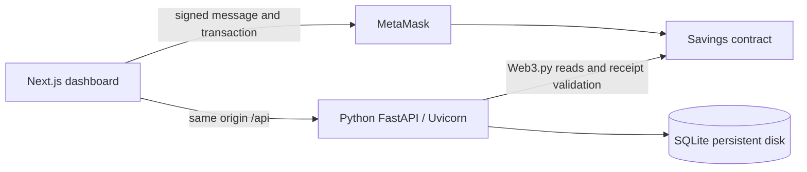

# Architecture and API

The Python backend uses FastAPI sync handlers in its worker thread pool, per-operation SQLite connections and Web3.py for read-only RPC. The Solidity vault is authoritative for balances; app roles govern private reporting. Docker runs Uvicorn on loopback port 4000 and Next.js on published port 10000. The supervisor exits if either child dies.

| Method | Route | Purpose / access |
| --- | --- | --- |
| GET | /api/health | Database/process liveness, no RPC availability claim |
| GET | /api/config | Public chain ID and configured address |
| POST | /api/register | Customer; adminCode or auditorCode invites privileged role |
| POST | /api/login, /api/logout | Create/revoke 24-hour opaque session |
| GET | /api/me | Current account profile |
| POST | /api/challenge, /api/wallet | Expiring one-use signed wallet proof |
| GET | /api/balance | Single-block principal, interest, reserve, owner and total principal |
| GET | /api/activity | Role-scoped event filter and pagination (page/pageSize/kind) |
| GET | /api/transactions | Compatible latest-500 array endpoint |
| POST | /api/transactions | Verified/idempotent receipt import; auditor forbidden |
| GET | /api/analytics | Four event series over 14 UTC recording dates |
| GET | /api/transactions/export | Up to 10,000 role-scoped CSV rows; formula-safe |
| GET | /api/audit | Admin/auditor account audit events, 20 rows/page |

Five tables: users, sessions, challenges, transactions, audit_log. Startup performs an additive migration of the original Node schema; Node's scrypt encoding remains compatible. New receipt rows contain both block time/hash and recording time. Audit records are new successful account/import events, not reconstructed historical activity or immutable external logs.

Customers see their own records. Admins see all wallets and account emails. Auditors see cross-account wallets without emails and cannot import receipts, while retaining wallet-proof/logout access. Read-only app roles do not restrict independent interactions with the public contract. The fee preview preserves amount/destination/fee bounds and expires in 60 seconds; wallet/chain changes clear it.
